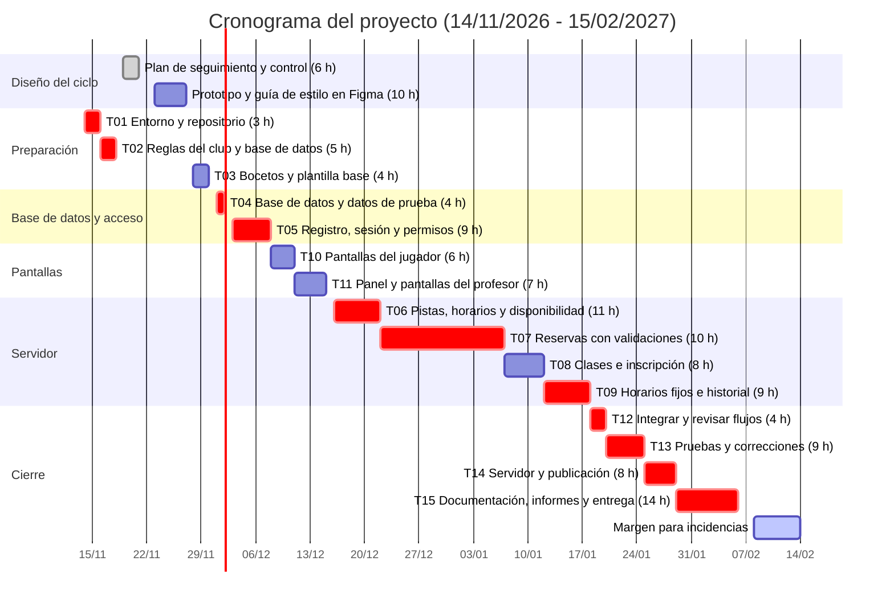

# Plan de ejecución

Resumen del plan de ejecución del proyecto *Gestión autónoma de reservas en un club de pádel* (Fase 3). El documento completo se entrega en PDF; aquí se guarda una versión de trabajo para consultarla y actualizarla durante el desarrollo.

## Tareas, dependencias y horas

| ID | Tarea | Resultado esperado | Tarea predecesora | Horas |
|---|---|---|---|---|
| T01 | Preparar el entorno y el repositorio | Una página PHP de prueba funciona en localhost y el repositorio tiene su estructura inicial | – | 3 |
| T02 | Cerrar las reglas del club y diseñar la base de datos | Documento de reglas en docs/ y diagrama de las tablas | – | 5 |
| T03 | Bocetos y plantilla base | Bocetos de las pantallas esenciales, lista de recursos con su licencia y plantilla que se ve bien en móvil y ordenador | T02 | 4 |
| T04 | Crear la base de datos y los datos de prueba | Base de datos creada con datos de prueba ficticios | T01, T02 | 4 |
| T05 | Registro, inicio de sesión y permisos | Se puede crear una cuenta, entrar y salir, y entrar en una pantalla de otro rol queda bloqueado | T03, T04 | 9 |
| T06 | Pistas, horarios y consulta de disponibilidad | Las pistas se gestionan desde el panel y para una fecha dada se muestran los huecos correctos | T04, T05 | 11 |
| T07 | Reservas con validaciones | Se reserva y cancela, y cada caso incompatible se rechaza con un mensaje | T06 | 10 |
| T08 | Clases por nivel e inscripción | No se puede entrar en una clase completa o de otro nivel | T05, T06 | 8 |
| T09 | Horarios fijos, historial y consultas del profesor | Se cancela una sesión y la franja se mantiene, y el historial y las consultas muestran los datos correctos | T07, T08 | 9 |
| T10 | Pantallas del jugador | Pantallas terminadas y adaptadas al móvil | T03, T04 | 6 |
| T11 | Panel de la coordinadora y pantallas del profesor | Panel y pantallas del profesor navegables | T03, T04 | 7 |
| T12 | Integrar y revisar los flujos | Reservar, apuntarse y gestionar el club funcionan de principio a fin | T09, T10, T11 | 4 |
| T13 | Pruebas y corrección de errores | Tabla de pruebas con el resultado de cada caso, fallos corregidos y comentarios anotados | T12 | 9 |
| T14 | Preparar el servidor y publicar | La aplicación funciona en una dirección web segura (HTTPS) y la configuración y la prueba de rendimiento quedan anotadas | T13 | 8 |
| T15 | Documentación, informes y entrega | Documentación e informes en el repositorio, y PDF y vídeo entregados con sus enlaces | T14 | 14 |

Total estimado: 111 horas de desarrollo. El cronograma reserva además unas 16 horas para trabajos de diseño del ciclo (plan de seguimiento y prototipo).

## Cronograma

Planificación inicial para una persona: 12 horas a la semana (2 horas por día laborable y 2 el sábado; media hora al día del 23/12 al 6/1). Desarrollo previsto del 14/11/2026 al 6/02/2027, con una semana de margen y entrega final prevista para la semana del 15/02/2027. Las fechas son una referencia y se revisarán si hay retrasos.

Las tareas en rojo forman el camino más largo. La versión en imagen del diagrama está en el PDF de la Fase 3.

## Procedimiento de trabajo

Procedimiento sencillo, que puedo seguir yo sola durante todo el curso y ajustar si hace falta.

- **Tareas pendientes.** Tablero de GitHub Projects con tres columnas: Pendiente, En curso y Hecho. Cada tarea (T01 a T15) es una issue, con su descripción y su resultado esperado. Trabajo solo en una o dos tareas a la vez, siguiendo el orden del Gantt.
- **Progreso.** Cada domingo hago una revisión corta de 15 minutos: muevo las tareas en el tablero, comparo con el Gantt y anoto en [seguimiento.md](seguimiento.md) si voy adelantada o con retraso. Si me retraso, ajusto las fechas siguientes.
- **Control de versiones.** Git y GitHub. El código está siempre en el repositorio y subo los cambios al terminar cada sesión de trabajo.
- **Ramas.** `main` contiene siempre la versión que funciona. Para cada tarea creo una rama propia (por ejemplo `t07-reservas`) y, cuando está terminada y probada, la uno a `main` y la borro.
- **Commits.** Pequeños, al menos uno por sesión y siempre que complete una parte que funcione. El mensaje empieza con el número de la tarea, por ejemplo: `T07: validar que la pista no esté ocupada`.
- **Decisiones importantes.** Se anotan en [decisiones.md](decisiones.md), con fecha, qué decido y por qué.
- **Incidencias.** Cada fallo es una issue con la etiqueta «incidencia»: qué pasó, cómo se reproduce y cómo se arregló. Las pruebas de la T13 también se registran así.
- **Tarea terminada.** Cuando cumple el resultado esperado de la tabla, no rompe lo que ya funcionaba, está subida y unida a `main`, y su issue está cerrada.
- **Datos sensibles.** No subo contraseñas, claves ni datos reales. Las claves de la base de datos van en un archivo aparte que no se sube al repositorio.
- **Copias de seguridad.** El repositorio es la copia principal del código. Cada semana exporto la base de datos (archivo SQL con datos ficticios) desde phpMyAdmin y copio la carpeta del proyecto a OneDrive educativo, manteniendo las dos últimas versiones.

## Hitos

- H1: base de datos lista.
- H2: acceso y permisos.
- H3: núcleo del servidor.
- H4: aplicación integrada.
- H5: aplicación probada.
- H6: aplicación publicada.
- Entrega final prevista: semana del 15/02/2027.
